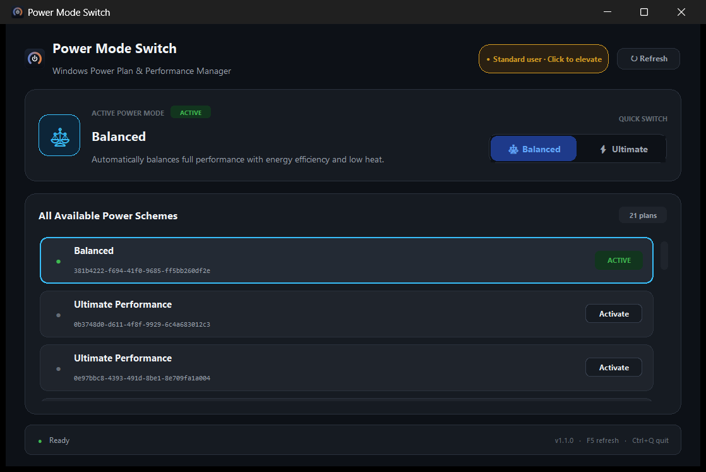

# Power Mode Switch

A modern, lightweight Windows 11 Fluent power-plan manager and toggle utility. Switch seamlessly between **Balanced** and **Ultimate Performance** modes with one click, inspect all installed power schemes, or control everything via CLI and standalone `.exe`.



---

## Features

- **Windows 11 Fluent Design**: Built with CustomTkinter, featuring card layouts, real-time status banners, mode icons, and DWM dark title-bar integration.
- **One-Click Quick Toggle**: Instant segmented toggle between Balanced and Ultimate Performance.
- **Full Scheme Discovery**: Lists and manages all power schemes (Balanced, High Performance, Power Saver, Ultimate Performance, OEM custom plans).
- **Background Execution**: All `powercfg` operations run asynchronously so the interface never freezes or stutters.
- **Automatic UAC Elevation**: Intelligently detects administrator privileges and elevates automatically when switching plans without dropping the working directory.
- **Standalone Executable**: Packaged with PyInstaller into a single, portable `PowerModeSwitch.exe` with embedded icon and metadata.
- **Dual Mode**: Works as an interactive GUI or a scriptable CLI with informative exit codes.

---

## Quick Start

### 1. Run the GUI

```powershell
# Using Python
python gui.py

# Or without a console window
pythonw gui.py
```

### 2. CLI Usage

The core engine `power_mode.py` can be used standalone or automated in scripts:

```powershell
python power_mode.py toggle    # Flip between Balanced <-> Ultimate Performance
python power_mode.py list      # List all power plans and identify the active scheme
python power_mode.py diag      # Run comprehensive power diagnostic report
python power_mode.py --help    # Show all CLI commands and options
```

### 3. Exit Codes (CLI)

| Code | Meaning |
|:----:|:--------|
| `0`  | Success |
| `1`  | Not elevated / UAC elevation denied |
| `2`  | Ultimate Performance scheme unavailable or enable failed |
| `3`  | `powercfg /setactive` failed |
| `4`  | Current plan is neither Balanced nor Ultimate |

---

## Building Standalone `.exe`

To package the application into a standalone Windows executable (`dist/PowerModeSwitch.exe`):

```powershell
# 1. Install development dependencies
pip install -r requirements-dev.txt

# 2. Run the automated build script
.\build.ps1
```

The compiled binary will be placed in `dist\PowerModeSwitch.exe`.

---

## Project Structure

```
Power Mode Switch/
├── gui.py                 # Modern Windows 11 Fluent GUI (CustomTkinter)
├── power_mode.py          # Core engine (powercfg wrappers, scheme detection, CLI)
├── test_power_mode.py     # Core regression test suite (4/4 tests)
├── build.ps1              # Production PyInstaller build script
├── PowerModeSwitch.spec   # PyInstaller spec with assets, hooks & metadata
├── version_info.txt       # Windows PE version and copyright resource info
├── requirements.txt       # Runtime dependencies (customtkinter)
├── requirements-dev.txt   # Build dependencies (pyinstaller, pillow)
├── screenshot.png         # UI preview screenshot
├── assets/                # Application icons (.ico and .png in multiple sizes)
└── tools/                 # Development and capture utilities
```

---

## System Requirements

- **Operating System**: Windows 10 (1809+) or Windows 11 (64-bit recommended)
- **Python**: Python 3.10+ (if running from source)
- **Permissions**: Administrator privileges are required by Windows to switch power schemes. The app will prompt for UAC automatically when needed.

---

## License

MIT License. Feel free to use, modify, and distribute.
